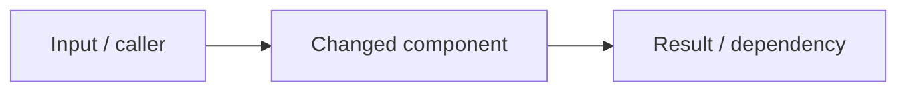

# PR Creation

Make the change easy to understand and review. A reader should grasp the **goal**, the **important decisions**, and the **verification** in under a minute.

## Workflow

1. **Inspect the change**
   - Read repository instructions and the PR template, if present.
   - Check the branch, working tree, base diff, recent commits, and existing PR.
   - Identify the goal, key architectural boundaries, relevant user journey, risks, and follow-ups.
2. **Collect existing verification evidence**
   - Read the verification record or evidence index created during implementation/verification, if available.
   - Use its actual commands, outcomes, timestamps, and artifact paths. Do not repeat tests or reproduce UI work merely to prepare a PR.
   - If evidence is missing or ambiguous, report that gap. Run checks that are missing, failed or invalidated by later changes, project-mandated gates, and any the user expressly requires.
3. **Choose the PR state**
   - Follow the user's request and repository conventions for draft vs. ready.
   - Prefer updating an existing PR over creating a duplicate.
4. **Write the title and body** using the principles below.
5. **Create or update with `gh`**, using `--body-file` for multiline Markdown.
6. **Verify the result**: title, body, base branch, head branch, draft state, and URL.

## Write for scanning

- Lead with the **user or system outcome**, not a list of changed files.
- Keep paragraphs to one to three short sentences.
- Use bullets for independent facts and decisions.
- Use **bold labels** such as `**Rollout:**`, `**UI:**`, and `**Why this approach?**`.
- Use `inline code` for flags, commands, identifiers, and paths.
- Use *italics* sparingly for caveats or explicit non-applicability.
- Include a compact **architecture diagram** for every PR that changes code or system behavior. Use Mermaid when supported by the hosting platform; otherwise use a readable text diagram. Show only the components and relationships needed to review this change.
- Include a **user-flow diagram** when the change affects a user-facing journey, UI state transitions, or an operator workflow. Omit it for changes with no meaningful flow and do not force one.
- Keep diagrams accurate to the diff; distinguish existing components from changed/new ones where useful.
- Avoid walls of text, nested bullets, repeated context, and ornamental formatting.
- Default to roughly **250–500 words**, excluding required template boilerplate. Expand only when risk or complexity requires it.

## Focus on decisions

Use these sections and concepts only when actually relevant:

- **Goal:** What becomes possible, fixed, or safer?
- **Approach:** What is the smallest coherent implementation?
- **Key decision:** Why was this approach chosen over the meaningful alternative?
- **Trade-off:** What does the chosen approach delay, limit, or leave unchanged?
- **Out of scope:** What follow-up work is intentionally separate?
- **Rollout and risk:** Feature flags, migrations, compatibility, failure posture, or rollback when relevant.

Do not narrate implementation chronology. Mention files and low-level mechanics only when they help a reviewer evaluate correctness, but the PR description is not about what particular code changes were made: there's a file diff for that.

## Review outline

For every PR that changes code, load the `review-outline` skill and add its outline in PR mode: a collapsed `<details><summary>Review outline</summary>` block after the goal. Its flow sections use the outline's arrow-chain and step-table notation, so do not repeat them as separate Architecture or User flow sections. The outline does not count toward the word budget above.

## Respect repository conventions

- Use the repository's PR template and preserve required headings, checklists, comments, and reviewer guidance.
- If no template exists, adapt the preferred body pattern below; retain `Implementation`, `Testing`, or `UI` headings only when they improve clarity.
- Follow the repository's title convention; otherwise use a short imperative or Conventional Commit title consistent with recent PRs.
- Keep required boilerplate intact but make authored sections concise.

## Ground every claim

- Read the diff before describing behavior.
- Report only tests and checks that actually ran, using the verification record as the source of truth. Do not repeat tests merely to prepare the PR.
- Never invent screenshots, recordings, timing, rollout audiences, performance claims, or production impact.
- For UI changes, link/embed screenshots or a short recording captured during verification. If unavailable, state that clearly; do not repeat verification solely to create proof. Put them in a collapsible element so they don't make the PR description unnecessarily long.
- Clearly separate current behavior from planned follow-up work.

## Preferred body pattern

Adapt this to the repository template rather than replacing it:

````md
## Goal
[One or two sentences describing the outcome.]

## Architecture

**Decision:** [Important choice and trade-off, if any.]

## User flow
[Include a Mermaid flowchart only when the change affects a meaningful user/operator journey.]

## Verification
- `command` — [result, from the verification record]
- **UI proof:** [screenshot/video links, or “Not applicable” / why unavailable]
````

## Final editing pass

Before publishing, ask:

- Can a reviewer understand the goal and key decision in 30 seconds?
- Is each paragraph shorter than the idea it explains?
- Do bullets describe behavior and trade-offs rather than merely files?
- Is the architecture diagram present and readable?
- Is a user-flow diagram included when relevant, and omitted when not?
- Are verification claims and visual proof sourced from evidence already collected?
- Are follow-ups and missing UI proof explicit?
- Is any sentence duplicated or unsupported?
- Does the body still follow the repository template?
Trim until every sentence helps the reviewer decide whether the change is correct and appropriately scoped.
